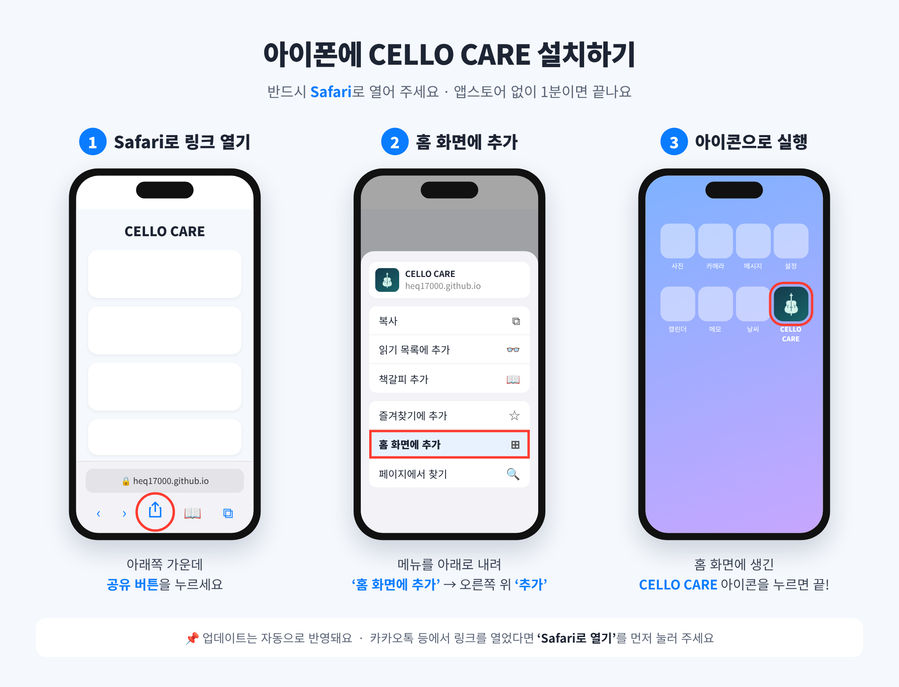

# CELLO CARE

첼리스트를 위한 운동 루틴과 컨디션 기록 앱

## 📱 아이폰 (iPhone)

**👉 [아이폰용 CELLO CARE 열기](https://heq17000.github.io/cello-care-releases/)**

1. 위 링크를 아이폰 **Safari**로 엽니다.
2. 아래쪽 **공유 버튼(□↑)** → **홈 화면에 추가**를 누릅니다.
3. 홈 화면의 CELLO CARE 아이콘으로 실행하세요. 업데이트는 자동으로 반영됩니다.

## 🤖 안드로이드 (Android)

**👉 [최신 APK 다운로드](https://github.com/heq17000/cello-care-releases/releases/latest)**

Assets의 `CELLO-CARE-vX.Y.Z.apk`를 Android 8.0 이상 기기에서 열어 설치하세요.
